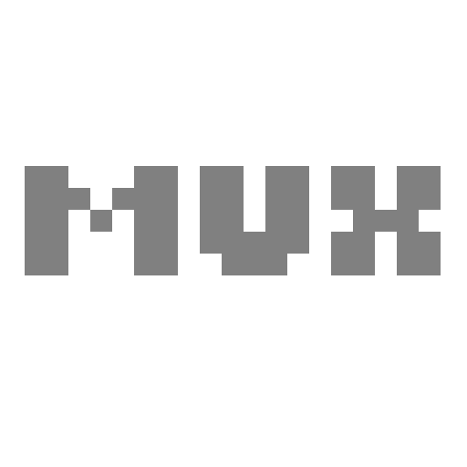

<p align="center">
  
</p>

<p align="center"><em>Your mux machines, from anywhere.</em></p>

# Mux Cloud

Mux Cloud lets you use the [mux](https://github.com/jchristn/Mux) agents running on your own computers from a browser
on another computer or from your phone. Each machine keeps one outbound WebSocket open to Mux Cloud. When you pick a
machine, you get that machine's own mux dashboard and conversations, exactly as if you were sitting at it.

Conversations stay on your machines. Mux Cloud stores your account and the list of your machines, and passes traffic
through.

Hosted at [app.usemux.ai](https://app.usemux.ai). The code is MIT licensed, and you can run your own.

> **Status:** 0.1.0-alpha, under active development. See [PLAN.md](PLAN.md) for the architecture and roadmap.

## Repository layout

| Path | Contents |
| --- | --- |
| `src/MuxCloud.Protocol` | Tunnel wire contract shared with mux (NuGet `MuxCloud.Protocol`) |
| `src/Test.Shared` | Every test suite (Touchstone) |
| `src/Test.Automated`, `src/Test.Xunit3`, `src/Test.Nunit` | Runners for the shared suites |
| `WEBSOCKETS_API.md` | Tunnel, account events, and relayed WebSocket reference |

## Building and testing

Requires the .NET 8 and .NET 10 SDKs.

```
dotnet build src/MuxCloud.sln
dotnet run --project src/Test.Automated --framework net10.0
dotnet test src/Test.Xunit3
dotnet test src/Test.Nunit
```

## AOT support

`MuxCloud.Protocol` is AOT compatible: it uses source-generated JSON and no reflection. The server is not AOT
compatible yet. That will be revisited once its dependencies are settled.

## License

MIT. See [LICENSE.md](LICENSE.md).
